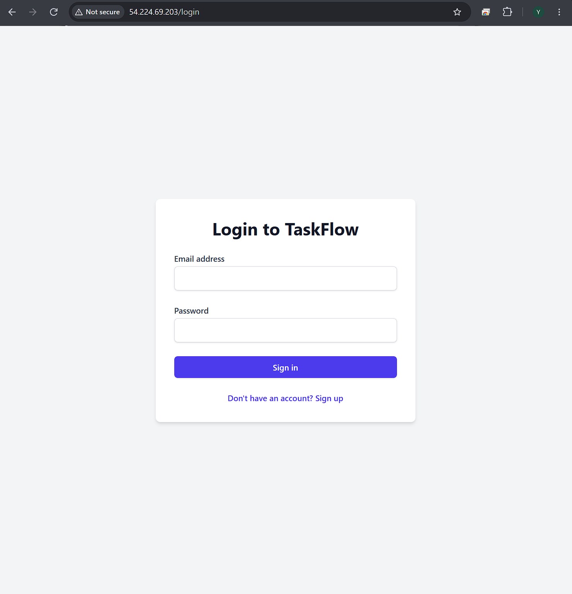

# 🚀 TaskFlow
### Full-Stack Cloud Deployment | DevOps Portfolio Project

<p align="center">
  <b>A Containerized Task Management Application Deployed on AWS EC2</b>
</p>

<p align="center">
  
  
  
  
</p>

---

## 📌 About The Project

**TaskFlow** is a full-stack task management application built with Laravel and React, featuring a Kanban Board interface for organizing tasks efficiently.

This project demonstrates the implementation of cloud infrastructure and DevOps practices, including containerization, automated CI/CD deployment, server security, and infrastructure monitoring.

### ✨ Key Features

- User registration and authentication.
- Create, update, and delete Boards.
- Task management with CRUD operations.
- Drag-and-drop task management.
- REST API powered by Laravel.
- Containerized application deployment.

## 🛠️ Technology Stack

| Category | Technology |
|---|---|
| Backend | PHP 8.3, Laravel 12 |
| Frontend | React 19, Vite |
| Database | MySQL 8.0 |
| Web Server | Nginx |
| Containerization | Docker, Docker Compose |
| Cloud Platform | AWS EC2 |
| CI/CD | GitHub Actions |
| CI/CD Runner | Self-Hosted Runner |
| Monitoring | Prometheus, Grafana |
| Infrastructure Metrics | Node Exporter, cAdvisor |
| Operating System | Ubuntu Server |

## 🖥️ Application Preview

### Login Page

User authentication interface for accessing TaskFlow.



### Dashboard

Main dashboard for managing boards and tasks.


## ☁️ Cloud Infrastructure – AWS EC2

TaskFlow is deployed on an AWS EC2 instance running Ubuntu Server.

Infrastructure implementation includes:

- EC2 instance provisioning.
- Security Group configuration.
- UFW firewall configuration.
- Docker and Docker Compose installation.
- Nginx reverse proxy configuration.


## 🐳 Docker Containerization

The application uses Docker Compose to run its production services independently.

| Container | Responsibility |
|---|---|
| `kanban_nginx_prod` | Reverse proxy |
| `kanban_app_prod` | Laravel backend |
| `kanban_db_prod` | MySQL database |
| `kanban_frontend_prod` | React frontend |


## ⚙️ CI/CD – GitHub Actions

Automated CI/CD pipeline using GitHub Actions and a Self-Hosted Runner on AWS EC2.

### Pipeline Workflow

```text
Developer Push
      |
      v
GitHub Actions
      |
      v
Checkout Source Code
      |
      v
Backend Build & Testing
      |
      v
Frontend Lint & Build
      |
      v
Sync Application to EC2
      |
      v
Docker Compose Build
      |
      v
Database Migration
      |
      v
Laravel Optimization
      |
      v
Health Check
      |
      v
Deployment Success
```

Deployment proceeds only after the testing stages succeed.

### Pipeline Execution


**Workflow File:** `.github/workflows/deploy.yml`

**View Pipeline:** [GitHub Actions – TaskFlow](https://github.com/yudhaafrizarevi/project1/actions)

## 📊 Monitoring & Observability

Infrastructure monitoring is implemented using Prometheus and Grafana.

| Component | Purpose |
|---|---|
| Prometheus | Metrics collection and storage |
| Grafana | Metrics visualization |
| Node Exporter | Linux server monitoring |
| cAdvisor | Docker container monitoring |

### Monitored Metrics

- CPU Usage
- Memory Usage
- Disk Usage
- Network Traffic
- Docker Container Metrics

### Grafana Dashboard


## 🔐 Security Implementation

Security measures implemented in the project:

- AWS Security Group access restrictions.
- UFW firewall configuration.
- SSH access restrictions.
- MySQL database isolated from public internet.
- Monitoring services restricted to localhost.
- Production environment variables excluded from GitHub.
- Laravel debug mode disabled in production.

## 📁 Repository Structure

```text
project1/
├── .github/
│   └── workflows/
│       └── deploy.yml
├── backend/
├── frontend/
├── nginx/
├── monitoring/
├── docs/
│   ├── loginpage.png
│   ├── dashboard.png
│   ├── aws-ec2.png
│   ├── docker-container.png
│   ├── github-action.png
│   └── dashboard_grafana.png
├── docker-compose.yml
├── docker-compose.prod.yml
└── README.md
```

## 🎯 Learning Outcomes

Through this project, I implemented and explored:

- Full-stack application deployment on AWS.
- Linux server administration.
- Docker containerization.
- Nginx reverse proxy.
- CI/CD automation using GitHub Actions.
- Automated backend and frontend testing.
- Infrastructure monitoring with Prometheus and Grafana.
- Basic cloud infrastructure security.

---

## 🔗 Project Links

| Resource | Link |
|---|---|
| GitHub Repository | [TaskFlow Repository](https://github.com/yudhaafrizarevi/project1) |
| CI/CD Pipeline | [GitHub Actions](https://github.com/yudhaafrizarevi/project1/actions) |
| Application | Temporarily unavailable (AWS EC2 instance stopped) |

---

<p align="center">
  <b>TaskFlow – Full-Stack Cloud Deployment</b>
  <br/>
  Cloud Computing • DevOps • Infrastructure Engineering • CI/CD Automation
</p>
