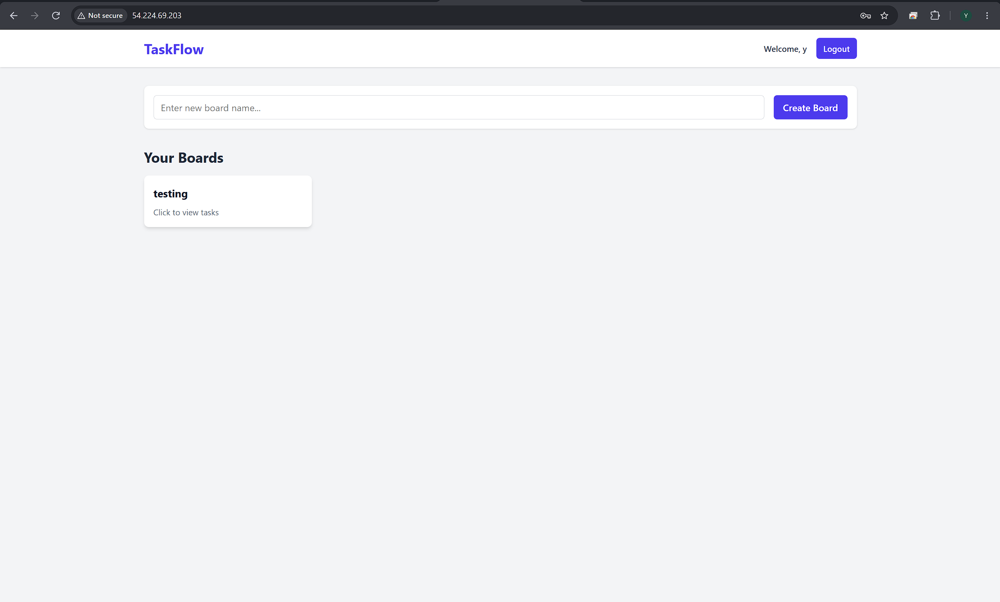
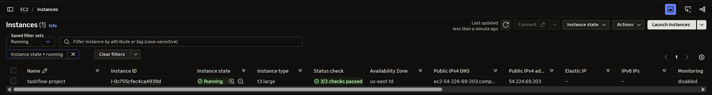
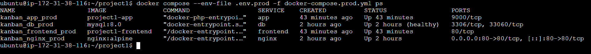
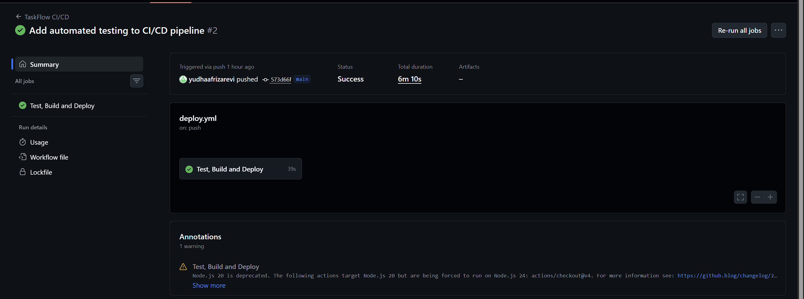
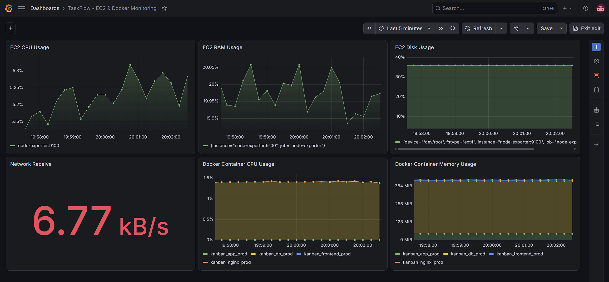

# TaskFlow – Full-Stack Cloud Deployment

**TaskFlow** adalah aplikasi manajemen tugas berbasis Kanban Board yang dikembangkan menggunakan Laravel dan React. Proyek ini merupakan implementasi deployment aplikasi full-stack ke AWS EC2 dengan Docker, CI/CD otomatis, konfigurasi keamanan, serta monitoring infrastruktur.

## 1. Project Overview

TaskFlow merupakan aplikasi manajemen tugas yang memungkinkan pengguna mengelola pekerjaan melalui beberapa tahapan, mulai dari To Do, In Progress, hingga Done.

Proyek ini tidak hanya berfokus pada pengembangan aplikasi, tetapi juga implementasi infrastruktur cloud, containerization, automation, monitoring, dan deployment.

**Fitur utama:**
- Registrasi dan autentikasi pengguna.
- Membuat, melihat, mengubah, dan menghapus Board.
- CRUD (Create, Read, Update, Delete) Task.
- Drag and drop Task antar-kolom Kanban.
- REST API menggunakan Laravel.
- Deployment aplikasi menggunakan Docker Compose.

## 2. Technology Stack

| Komponen | Teknologi |
|---|---|
| Backend | PHP 8.3, Laravel 12 |
| Frontend | React 19, Vite |
| Database | MySQL 8.0 |
| Web Server | Nginx |
| Containerization | Docker, Docker Compose |
| Cloud Provider | Amazon Web Services (AWS) |
| Compute | Amazon EC2 |
| CI/CD | GitHub Actions |
| CI/CD Runner | GitHub Self-Hosted Runner |
| Monitoring | Prometheus, Grafana |
| Infrastructure Monitoring | Node Exporter, cAdvisor |
| Operating System | Ubuntu Server |

## 3. Application Preview

### Login Page

Halaman autentikasi untuk pengguna TaskFlow.


### Dashboard

Halaman utama untuk melihat dan mengelola Board.



### Kanban Board

Pengelolaan tugas berdasarkan status pekerjaan menggunakan Kanban Board.

> Tambahkan screenshot Kanban Board di bagian ini setelah tersedia.

## 4. System Architecture

TaskFlow menggunakan arsitektur containerized full-stack application yang berjalan pada AWS EC2.

### Application Architecture

```text
                    Internet
                       |
                       v
                  AWS EC2
                       |
                       v
                    Nginx
                 Reverse Proxy
                       |
             +---------+---------+
             |                   |
             v                   v
       React Frontend       Laravel API
       Nginx Container      PHP-FPM Container
                                 |
                                 v
                            MySQL 8.0
                           DB Container
```

### Monitoring Architecture

```text
                 AWS EC2 Server
                       |
             +---------+---------+
             |                   |
             v                   v
       Node Exporter          cAdvisor
       Host Metrics        Docker Metrics
             |                   |
             +---------+---------+
                       |
                       v
                  Prometheus
                       |
                       v
                    Grafana
                  Dashboard
```

Monitoring dijalankan menggunakan Docker Compose terpisah dari application stack.

## 5. Cloud Infrastructure – AWS EC2

Aplikasi TaskFlow di-deploy pada Amazon EC2 dengan Ubuntu Server sebagai sistem operasi.

Implementasi infrastruktur meliputi:

- Provisioning EC2 instance.
- Konfigurasi Security Group.
- Konfigurasi UFW Firewall.
- Deployment Docker dan Docker Compose.
- Konfigurasi Nginx sebagai reverse proxy.
- Pemisahan service aplikasi dan database.
- Konfigurasi swap untuk membantu pengelolaan memori server.

### Screenshot AWS EC2



## 6. Docker Containerization

Seluruh komponen aplikasi dijalankan menggunakan Docker Compose.

Container production:

| Container | Fungsi |
|---|---|
| kanban_nginx_prod | Reverse proxy dan web entry point |
| kanban_app_prod | Laravel PHP-FPM |
| kanban_db_prod | MySQL database |
| kanban_frontend_prod | React frontend |

Database MySQL berjalan pada jaringan internal Docker dan tidak diekspos langsung ke internet.

### Docker Containers



### Production Deployment

File konfigurasi utama:

- `docker-compose.prod.yml`
- `backend/Dockerfile.prod`
- `frontend/Dockerfile.prod`
- `nginx/production/default.conf`

## 7. CI/CD Pipeline – GitHub Actions

TaskFlow menggunakan GitHub Actions dengan Self-Hosted Runner yang berjalan pada EC2.

Pipeline dijalankan ketika terdapat push ke branch `main` atau melalui manual workflow dispatch.

### Pipeline Workflow

```text
          Developer Push
                |
                v
          GitHub Actions
                |
                v
             Checkout
                |
                v
        Backend Docker Build
                |
                v
          Backend Testing
                |
                v
        Frontend Lint & Build
                |
                v
         Sync Application
                |
                v
        Docker Compose Build
                |
                v
          Database Migration
                |
                v
         Laravel Optimization
                |
                v
            Health Check
                |
                v
          Deployment Success
```

Deployment hanya dilanjutkan apabila tahap testing berhasil.

### GitHub Actions Result



File workflow:

`.github/workflows/deploy.yml`

## 8. Automated Testing

Pipeline CI/CD menjalankan pengujian backend dan frontend sebelum deployment.

### Backend Testing

- Menggunakan Pest untuk Laravel.
- Menggunakan SQLite in-memory untuk environment testing.
- Pengujian berjalan di dalam Docker test image.
- Testing tidak menggunakan database production.

Hasil pengujian terakhir:

**2 tests passed (2 assertions).**

### Frontend Testing

- ESLint untuk pemeriksaan kode.
- Vite untuk proses production build.

Kedua tahap harus berhasil sebelum deployment dilakukan.

## 9. Monitoring & Logging

TaskFlow menggunakan Prometheus dan Grafana untuk monitoring infrastruktur.

### Monitoring Components

| Komponen | Fungsi |
|---|---|
| Prometheus | Mengumpulkan dan menyimpan metrics |
| Grafana | Visualisasi metrics |
| Node Exporter | Monitoring resource Linux |
| cAdvisor | Monitoring Docker containers |

### Metrics yang Dimonitor

- CPU Usage
- Memory Usage
- Disk Usage
- Network Traffic
- Docker Container Metrics

Prometheus melakukan pengumpulan metrics dengan interval 15 detik dan retention selama 7 hari.

### Grafana Dashboard



### Prometheus Configuration

File konfigurasi:

- `monitoring/docker-compose.yml`
- `monitoring/prometheus/prometheus.yml`

Data Grafana dan Prometheus disimpan menggunakan Docker named volumes agar tetap persisten ketika container diperbarui.

Monitoring service dibatasi pada localhost server dan tidak diekspos langsung ke internet.

## 10. Security Implementation

Beberapa konfigurasi keamanan yang diterapkan:

- AWS Security Group untuk membatasi akses jaringan.
- UFW Firewall dengan kebijakan incoming deny.
- SSH hanya diizinkan dari IP yang diperbolehkan.
- Database MySQL tidak diekspos ke public internet.
- Prometheus dan Grafana hanya dapat diakses melalui localhost server.
- Laravel `APP_DEBUG=false` pada production.
- File environment dan credential tidak disimpan di GitHub.
- Testing menggunakan database terpisah dari production.

## 11. Repository Structure

```text
project1/
├── .github/
│   └── workflows/
│       └── deploy.yml
├── backend/
│   ├── app/
│   ├── config/
│   ├── database/
│   ├── routes/
│   ├── tests/
│   ├── Dockerfile
│   ├── Dockerfile.prod
│   └── Dockerfile.test
├── frontend/
│   ├── src/
│   ├── Dockerfile.dev
│   └── Dockerfile.prod
├── nginx/
│   ├── default.conf
│   └── production/
│       └── default.conf
├── monitoring/
│   ├── prometheus/
│   │   └── prometheus.yml
│   ├── docker-compose.yml
│   ├── .env.example
│   └── README.md
├── docs/
│   └── screenshots/
├── docker-compose.yml
├── docker-compose.prod.yml
└── README.md
```

## 12. Deployment Guide

### Prerequisites

- Ubuntu Server atau Linux.
- Docker Engine.
- Docker Compose Plugin.
- Git.
- AWS EC2 atau server Linux lainnya.

### Clone Repository

```bash
git clone https://github.com/yudhaafrizarevi/project1.git

cd project1
```

Repository ini menggunakan konfigurasi production dan environment variables yang harus disiapkan secara terpisah.

### Environment Configuration

Siapkan file `.env.prod` sesuai konfigurasi production.

Jangan menggunakan credential production yang dibagikan melalui repository publik.

### Build and Run

```bash
docker compose \
  --env-file .env.prod \
  -f docker-compose.prod.yml \
  up -d --build
```

### Database Migration

```bash
docker compose \
  --env-file .env.prod \
  -f docker-compose.prod.yml \
  exec app php artisan migrate --force
```

### Check Container Status

```bash
docker compose \
  --env-file .env.prod \
  -f docker-compose.prod.yml \
  ps
```

### Health Check

```bash
curl http://127.0.0.1/up
```

## 13. Monitoring Deployment

Untuk menjalankan monitoring secara terpisah:

```bash
cd monitoring

cp .env.example .env
```

Atur password Grafana pada file `.env`, kemudian jalankan:

```bash
docker compose up -d
```

Periksa container:

```bash
docker compose ps
```

Akses service secara lokal pada server:

- Prometheus: `http://127.0.0.1:9090`
- Grafana: `http://127.0.0.1:3000`

Untuk mengakses dari komputer lokal, gunakan SSH tunnel.

## 14. Project Repository

GitHub Repository:

https://github.com/yudhaafrizarevi/project1

## 15. Project Objectives & Learning Outcomes

Melalui proyek ini, implementasi yang dilakukan mencakup:

- Full-stack application deployment.
- Cloud infrastructure provisioning menggunakan AWS EC2.
- Containerization menggunakan Docker.
- Reverse proxy menggunakan Nginx.
- Automated CI/CD menggunakan GitHub Actions.
- Backend dan frontend automated testing.
- Infrastructure monitoring menggunakan Prometheus dan Grafana.
- Basic server hardening dan network security.
- Deployment automation dan application health check.

---

**Project:** TaskFlow – Full-Stack Cloud Deployment  
**Focus:** Cloud Computing, DevOps, Infrastructure Engineering, CI/CD & Automation
